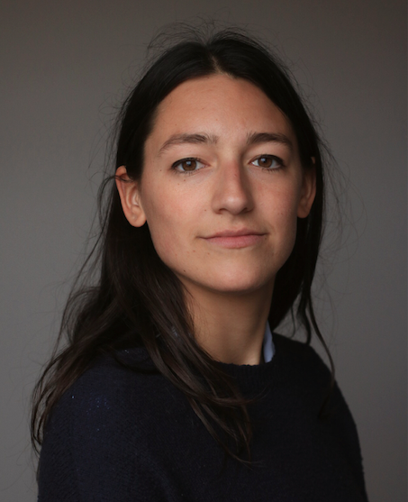

# Welcome to my website!

{ width="220" style="float: right; margin: 0 0 1rem 1rem;" }

I am a PhD candidate at ECARES at the Université libre de Bruxelles, under the supervision of Estelle Cantillon.

My research interests lie at the boundary between Industrial Organization and Energy and Environmental Economics. 

I currently focus on the design of electricity markets to support the energy transition.

In Spring 2026 I visited the Toulouse School of Economics (TSE), hosted by Stefan Ambec in the Environmental Group.

I am on the Job Market this year.
